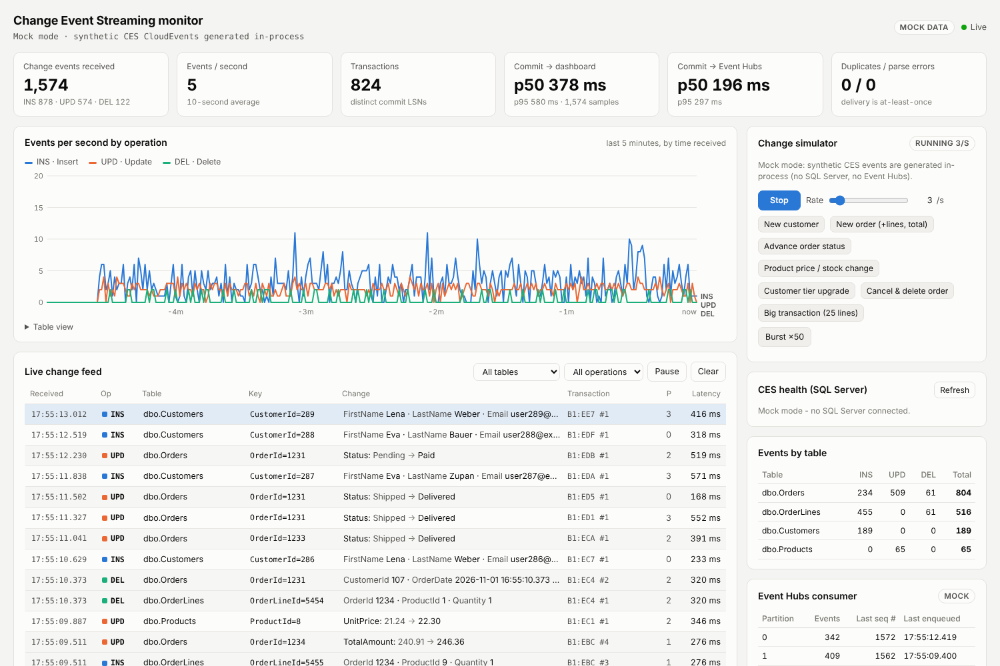
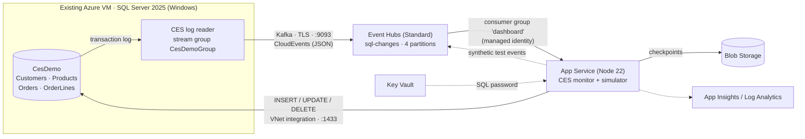

# SQL Server 2025 Change Event Streaming: end-to-end demo

This demo streams row changes from SQL Server 2025 on your Azure VM to **Azure Event Hubs** using **Change Event Streaming (CES)**. A web app shows the events arriving and lets you generate changes.





Everything is in code. Bicep creates the Azure resources and also configures SQL Server, using a managed **Run Command** on your VM to run the T-SQL scripts.

## What's in the box

| Path | What it is |
|---|---|
| `infra/main.bicep` (+ `modules/`) | Event Hubs namespace, event hub, consumer group and a Send-only SAS policy; Storage for checkpoints; Key Vault; Log Analytics and App Insights; App Service plan and web app; a VNet integration subnet in the SQL VM's VNet; RBAC; and the Run Command that configures SQL. |
| `infra/main.bicepparam` | The only file you need to edit. |
| `infra/scripts/Configure-SqlCes.ps1` | Runs on the VM. It checks the version, opens Windows Firewall port 1433, tests the Kafka port to Event Hubs, then runs `sql/01` and `sql/02`. |
| `sql/01_create_demo_database.sql` | Demo database in FULL recovery with `PREVIEW_FEATURES = ON`, 4 tables, seed data, a low-privilege login, and an initial full backup. |
| `sql/02_enable_ces.sql` | Master key, credential (SAS **or** managed identity), `sp_enable_event_stream`, stream group (`AzureEventHubsApacheKafka`), and the tables. Idempotent. |
| `sql/03_generate_changes.sql` | Generates INSERT/UPDATE/DELETE traffic from SSMS, without the web app. |
| `sql/04_monitor_ces.sql` | Health queries: `sys.dm_change_feed_errors`, log scan sessions, log usage, `sp_help_change_feed*`. |
| `sql/05_log_backup_job.sql` | SQL Agent job for log backups, so the FULL-recovery log can truncate. |
| `sql/99_disable_ces.sql` | Teardown. |
| `app/` | Node.js web app: Event Hubs consumer, CloudEvent decoder with segment reassembly, live dashboard (Server-Sent Events), SQL change simulator, synthetic event injector, and CES health panel. |
| `deploy/deploy.sh`, `deploy/deploy.ps1` | One command for infrastructure, SQL configuration and app deployment. |

## Facts from the docs that shape the design

- On **SQL Server 2025** use `@destination_type = N'AzureEventHubsApacheKafka'` with `<namespace>.servicebus.windows.net:9093/<hub>`. AMQP was deprecated on 15 Aug 2026.
- The Kafka endpoint requires Event Hubs **Standard** or higher (Basic has no Kafka), so Bicep enforces this.
- CES is a **preview feature** in SQL Server 2025. It needs `ALTER DATABASE SCOPED CONFIGURATION SET PREVIEW_FEATURES = ON` and the **FULL** recovery model.
- **Windows only.** CES isn't supported on SQL Server 2025 on Linux.
- **Authentication**
  - **SAS** (a shared access policy with **Send** rights) works on every build.
  - **Managed identity** needs SQL Server 2025 **CU3+** on an Azure VM (or Arc) with Microsoft Entra auth configured for the instance.
- CES publishes to **public endpoints only** (no private endpoints yet). The VM therefore needs outbound TCP **9093** to `*.servicebus.windows.net`.
- **Rows that already exist are not streamed**, only changes made after CES is enabled. There is no snapshot.
- Delivery is at-least-once. Large events are split into segments that share a `logicalid` (`segmentindex` / `finalsegment`). The dashboard counts duplicates and reassembles segments.
- **The log can't truncate until changes are delivered.** On a VM that's your problem, not Azure's: a broken destination grows the transaction log. The dashboard shows log usage and `log_reuse_wait_desc`, and `sql/05` adds log backups.
- **Unsupported**
  - Tables with clustered columnstore, temporal history, Always Encrypted, memory-optimized, graph or external tables.
  - `TRUNCATE TABLE`, renaming tables or columns, and `SWITCH PARTITION`.
  - These column types are skipped: `json`, `xml`, `geography`, `geometry`, `rowversion`, `sql_variant`, `text`/`ntext`/`image`, `vector`, UDTs.

## Prerequisites

1. **Your SQL Server 2025 VM**
   - Windows, with the Azure VM agent running.
   - Outbound internet on TCP 9093 and 443, which is the NSG default.
   - Note its name, resource group, VNet and private IP.
2. **A free address range in that VNet** for the App Service integration subnet. A `/27` is enough (default `10.0.250.0/27`).
3. **A sysadmin account for the Run Command**, one of:
   - **SQL authentication** (mixed mode) with a sysadmin login, passed as `CES_SQL_ADMIN_LOGIN` / `CES_SQL_ADMIN_PASSWORD`. Recommended.
   - Leave both empty to use Windows auth as `NT AUTHORITY\SYSTEM`. This only works if SYSTEM is sysadmin.
   - Or set `configureSqlViaRunCommand = false` and run `sql/01` and `sql/02` yourself in SSMS (Query → **SQLCMD Mode**).
4. **Tools:** Azure CLI 2.60+ (`az bicep` included); `zip` and `openssl` (bash) or PowerShell 7.
5. **Permissions:** Owner, or Contributor + User Access Administrator, on the demo resource group. You also need Contributor on the VM's resource group (for the Run Command and the subnet).

## Deploy

```bash
# 1. Point the parameters at your VM
code infra/main.bicepparam      # vmName, vmResourceGroup, sqlServerHost, vnetName, appSubnetPrefix

# 2. Secrets as environment variables (never commit them)
export CES_SIMULATOR_PASSWORD='<strong password>'     # SQL login used by the web app
export CES_MASTER_KEY_PASSWORD='<strong password>'    # database master key
export CES_SQL_ADMIN_LOGIN='sqladmin'                 # sysadmin used by the Run Command
export CES_SQL_ADMIN_PASSWORD='<password>'

# 3. Go
./deploy/deploy.sh rg-ces-demo          # or: ./deploy/deploy.ps1 -ResourceGroup rg-ces-demo
```

The script prints the dashboard URL and the **admin token**. Paste the token into the dashboard's *Admin token* box; you need it for the simulator buttons. Expect 6–10 minutes for the first deployment, most of it the Run Command and App Service build.

To see the Run Command output (every `PRINT` from the SQL scripts):

```bash
az vm run-command show -g <vm-rg> --vm-name <vm> -n configure-sql-ces --expand instanceView \
  --query "instanceView.{state:executionState, out:output, err:error}" -o yaml
```

## Walk-through

1. Open the dashboard and press **Start** in *Change simulator*. Each tick is one transaction against SQL Server, for example a new order plus 1–3 order lines plus the total update.
2. Watch the **Live change feed**:
   - Rows from the same transaction share a background band and a commit LSN, and the `#n` sequence numbers run in order.
   - Partitions follow the `Table` partition key scheme, so each table always lands on the same partition.
3. Click any row to see the full CloudEvent:
   - Commit LSN, begin LSN and sequence number.
   - Partition and offset.
   - The **old → current** row images, with changed columns highlighted.
4. Try **Big transaction (25 lines)** and **Cancel & delete order**. In the cancel case, `ON DELETE CASCADE` deletes are streamed too.
5. The **KPIs** show two latencies:
   - *Commit → Event Hubs*: CES publish latency, measured with Event Hubs' enqueued time.
   - *Commit → dashboard*: end to end.
6. The **CES health** panel queries SQL Server directly: streaming flag, streamed tables, delivery errors, log usage.
7. **Inject 10 synthetic** publishes CES-shaped events straight to Event Hubs, with source `/synthetic`. Use it to prove the consumer side works while you troubleshoot SQL.

Without the web app, run `sql/03_generate_changes.sql` in SSMS. You can also view the raw messages in the portal: Event Hubs → `sql-changes` → **Data Explorer**.

### Example event (as received)

```json
{
  "specversion": "1.0",
  "type": "com.microsoft.SQL.CES.DML.V1",
  "source": "/",
  "id": "…",
  "logicalid": "…:000000B1000009300009:00000000000000000001",
  "time": "2026-11-01T16:30:10.123Z",
  "operation": "UPD",
  "segmentindex": 0,
  "finalsegment": true,
  "data": "{\"eventsource\":{\"db\":\"CesDemo\",\"schema\":\"dbo\",\"tbl\":\"Orders\",\"cols\":[…],\"pkkey\":[{\"columnname\":\"OrderId\",\"value\":\"42\"}],\"transaction\":{\"commitlsn\":\"…\",\"sequencenumber\":1,…}},\"eventrow\":{\"old\":\"{…Status: Paid…}\",\"current\":\"{…Status: Shipped…}\"}}"
}
```

`data`, `eventrow.old` and `eventrow.current` are **JSON strings inside JSON**, so decode them in three steps. See `app/src/cloudevent.js`, which is covered by tests using the documented example.

## Managed identity instead of SAS

1. Patch SQL Server 2025 to **CU3 or later**.
2. Configure Microsoft Entra authentication for the SQL VM. In the portal: SQL virtual machine → Security configuration → Microsoft Entra authentication. Pick the system-assigned identity or a user-assigned one.
3. In `main.bicepparam` set `cesAuthMode = 'ManagedIdentity'`. If you chose a user-assigned identity, also set `sqlManagedIdentityPrincipalId`.
4. Redeploy. Bicep grants **Azure Event Hubs Data Sender** on the single event hub (least privilege). The Run Command then recreates the credential as `IDENTITY = 'Managed Identity'` and rebuilds the stream group.

## Run the web app locally

```bash
cd app && npm install
npm run mock                      # UI preview: no Azure, synthetic events in-process -> http://localhost:8080
# Live: copy .env.sample to .env, fill it in, then:
az login && set -a && . ./.env && set +a && npm start
```

Live mode authenticates with `DefaultAzureCredential`. The deploy script grants your signed-in user Receiver/Sender on the hub and Blob Data Contributor. The simulator needs network access to SQL on port 1433. Run `npm test` for the CloudEvent decoder tests.

## Troubleshooting

| Symptom | Check |
|---|---|
| Nothing arrives; `sys.dm_change_feed_errors` shows auth errors | The SAS key was rotated or the policy lacks **Send**. Redeploy, which re-reads the key and rotates the credential. In MI mode, check CU3+, Entra configured on the VM, and the role assignment (can take a few minutes to apply). |
| Errors mentioning connect/timeout | Outbound **9093** is blocked (NSG, Azure Firewall, UDR). The Run Command output includes a `Test-NetConnection` result. |
| `sp_create_event_stream_group` fails | Event Hubs must be **Standard+** (Kafka). Check the destination format `ns.servicebus.windows.net:9093/hub`. |
| `log_reuse_wait_desc` stuck and log growing | CES can't deliver (see the errors above), or there are no log backups. Run `sql/05_log_backup_job.sql`. As a last resort, disable CES (`sql/99`). |
| Simulator: "Cannot reach SQL Server" | Check the VNet integration subnet, that `sqlServerHost` is the VM's **private** IP, that TCP is enabled in SQL Server Configuration Manager, and that the Windows Firewall rule exists (the Run Command adds it). |
| Simulator: "Login failed for ces_simulator" | SQL Server is in Windows-only auth mode. Enable mixed mode and restart the service. |
| Events show **parse errors** | The stream group must use `@encoding = N'JSON'`. This demo doesn't decode Avro binary. |
| `committime` looks off by hours | Known CES bug: on a non-UTC server the field carries a `Z` but holds local time. The KPIs use the CloudEvent `time` attribute (UTC) instead. |

## Cost and cleanup

The ongoing costs are:
- Event Hubs Standard (1 TU)
- App Service B1
- Small Log Analytics, Storage and Key Vault charges

Scale down or delete everything when you're done:

```bash
# 1. On the VM (SSMS, SQLCMD mode): sql/99_disable_ces.sql   <- do this first
# 2. Then:
./deploy/cleanup.sh rg-ces-demo <vm-rg> <vm-name> <vnet-name>
```

## Security notes

- Everything Azure-side uses Microsoft Entra ID and RBAC. The storage account has shared-key access disabled.
- The only key in the system is the Send-only SAS policy scoped to one event hub, used by SQL Server in SAS mode. It travels in a Run Command *protected parameter*.
- The web app's SQL password lives in Key Vault (Key Vault reference). Its SQL login has only `db_datareader`/`db_datawriter` and `VIEW DATABASE/SERVER STATE`.
- Write actions in the dashboard need the admin token. For anything beyond a demo, put App Service Authentication (Entra) in front of the site.
- CES streams **unmasked** data, regardless of dynamic data masking or row-level security. Treat the event hub as sensitive.

---
Reference: [Change event streaming overview](https://learn.microsoft.com/sql/relational-databases/track-changes/change-event-streaming/overview?view=sql-server-ver17) · [Configure CES](https://learn.microsoft.com/sql/relational-databases/track-changes/change-event-streaming/configure?view=sql-server-ver17) · [JSON message format](https://learn.microsoft.com/sql/relational-databases/track-changes/change-event-streaming/message-format?view=sql-server-ver17)
